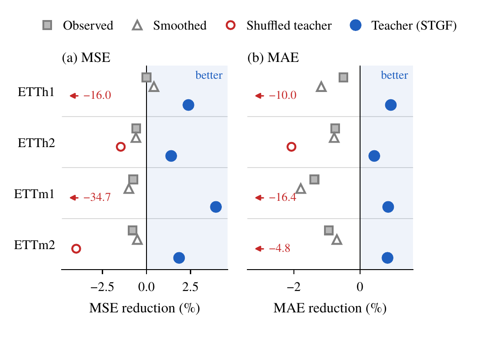
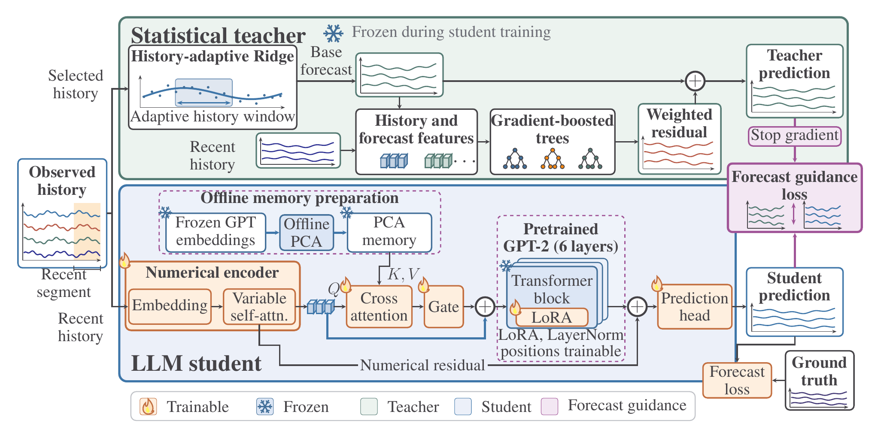

# STGF: Long-Term Time Series Forecasting with Large Language Models via Statistical Teacher Guidance

## Introduction

LLM-based forecasters are usually trained on observed futures together with auxiliary alignment objectives whose benefit for forecasting is unclear. STGF studies ***which auxiliary targets actually improve an LLM forecaster***, and guides a LoRA-adapted GPT-2 student with forecasts from an independently fitted and frozen **statistical teacher**.

With the student architecture, loss form, coefficients and valid windows held fixed, using teacher forecasts as auxiliary targets improves both MSE and MAE on the four ETT datasets, whereas observed, smoothed or shuffled targets do not (see [Figure 1](#fig-guidance)).

<p align="center" id="fig-guidance">
    
    <br>
    <strong>Figure 1:</strong> Effect of the auxiliary guidance target. Points show the relative MSE (a) and MAE (b) reduction (%) over supervision on observed targets only, averaged over four horizons and three seeds; positive values (shaded) indicate improvement.
</p>

STGF has three components (see [Figure 2](#fig-framework)):

- **Residual-Corrected Statistical Teacher.** A grouped Ridge forecaster selects its own lookback (up to 2,048 steps), local statistics window and penalty for every variable group and 24-step forecast block. Shallow gradient-boosted trees, fitted on chronological out-of-fold residuals, add a weighted correction. The teacher is fitted on training data only and frozen before student training.
- **LLM Student Adaptation.** Each variable is encoded as one token, queries a frozen PCA memory of GPT-2 word embeddings through gated cross-attention, and passes through the first six GPT-2 blocks adapted with LoRA. Only the LoRA, LayerNorm and positional parameters of the backbone are updated.
- **Forecast Guidance Loss.** The student learns from observed futures together with squared and absolute discrepancies from the precomputed teacher forecasts:

  ```
  L = MAE(Ŷ, Y) + λ · MSE(Ŷ, sg(T)) + β · MAE(Ŷ, sg(T)),    λ = β = 0.4
  ```

The teacher may use much longer histories than the student, but this information reaches the student only through precomputed targets. **The teacher is never executed at inference**: the deployed student forecasts from a 96-step input.

<p align="center" id="fig-framework">
    
    <br>
    <strong>Figure 2:</strong> Overview of STGF. A statistical teacher combines a history-adaptive Ridge forecast with a learned residual correction. During student training, the teacher is frozen and provides forecast-level supervision. The student retrieves from a frozen PCA memory and adapts a pretrained GPT-2 backbone with LoRA. Only the student is retained at inference.
</p>

## Main Results

Long-term forecasting with input length 96, averaged over horizons {96, 192, 336, 720} and reported as MSE / MAE. STGF and CALF† (our reproduction) average seeds 2021–2023. STGF achieves the best result in 13 of the 14 dataset-metric comparisons against the baselines reported in the paper.

| Dataset | STGF | CALF† | T-LLM | Time-LLM | PatchTST | iTransformer | DLinear |
|---|---|---|---|---|---|---|---|
| ETTm1 | **0.377 / 0.384** | 0.400 / 0.391 | 0.397 / 0.391 | 0.410 / 0.409 | 0.387 / 0.400 | 0.407 / 0.410 | 0.403 / 0.407 |
| ETTm2 | **0.277 / 0.318** | 0.285 / 0.324 | 0.278 / 0.319 | 0.296 / 0.340 | 0.281 / 0.326 | 0.288 / 0.332 | 0.350 / 0.401 |
| ETTh1 | **0.433 / 0.427** | 0.445 / 0.431 | 0.441 / 0.433 | 0.460 / 0.449 | 0.469 / 0.454 | 0.454 / 0.447 | 0.456 / 0.452 |
| ETTh2 | **0.367 / 0.394** | 0.376 / 0.398 | 0.374 / 0.396 | 0.389 / 0.408 | 0.387 / 0.407 | 0.383 / 0.407 | 0.559 / 0.515 |
| Weather | 0.248 / **0.270** | 0.252 / 0.274 | 0.246 / 0.271 | 0.274 / 0.290 | 0.259 / 0.281 | 0.258 / 0.278 | 0.265 / 0.317 |
| Electricity | **0.167 / 0.254** | 0.187 / 0.274 | 0.174 / 0.265 | 0.223 / 0.309 | 0.205 / 0.290 | 0.178 / 0.270 | 0.212 / 0.300 |
| Traffic | **0.424 / 0.264** | 0.453 / 0.294 | 0.437 / 0.287 | 0.541 / 0.358 | 0.481 / 0.304 | 0.428 / 0.282 | 0.625 / 0.383 |

## Prerequisites

Before proceeding, ensure Python 3.9+ is installed. Install the required dependencies with the following command:

```
pip install -r requirements.txt
```

## Dataset Preparation

Acquire datasets from [Autoformer](https://drive.google.com/drive/folders/1ZOYpTUa82_jCcxIdTmyr0LXQfvaM9vIy). Organize them in the `./datasets` directory as shown below:

```
datasets
├── electricity
│   └── electricity.csv
├── ETT
│   ├── ETTh1.csv
│   ├── ETTh2.csv
│   ├── ETTm1.csv
│   └── ETTm2.csv
├── traffic
│   └── traffic.csv
└── weather
    └── weather.csv
```

## Preparing the PCA Memory

Execute the command below to extract principal components from the GPT-2 word token embeddings:

```
python pca.py
```

The frozen memory will be saved in `./wte_pca_500.pt`.

## Model Training

Training scripts are located in the `./scripts` folder. Each script trains seeds 2021–2023 for the four horizons.

### Long-term Forecasting

For instance, to train STGF on the ETTh1 dataset, execute:

```
sh scripts/long_term_forecasting/ETTh1.sh
```

Each run has two stages:

1. **Teacher construction** (offline, once per dataset and horizon). The Ridge base forecaster is searched and fitted, out-of-fold forecasts are produced from the first 40%, 60% and 80% of the training interval, and the tree depth and correction weight η are selected by forward validation (η = 0 is the fallback). Teacher forecasts of all training windows are cached in `./teacher_cache` and reused by later runs and seeds.
2. **Student training** with the forecast guidance loss. The checkpoint is selected by validation MSE.

Teacher construction is the main additional cost of STGF. It is cheap on ETT but takes hours on Electricity and Traffic, most of it for the out-of-fold forecasts and the residual correction; `--teacher_residual 0` builds the cheaper Ridge-only teacher.

### Few-shot Forecasting

```
sh scripts/few_shot_forecasting/ETTh1.sh
```

Following the data protocol of CALF, only the first 10% of the training split is used (`--percent 10`). The teacher is refitted within this budget and uses the base forecaster only, with its configuration selected on the validation split.

### Zero-shot Forecasting

```
sh scripts/zero_shot_forecasting/ETTh1.sh
```

The student is trained on the source dataset with time-scale augmentation (`--time_scale_aug 1`), which transforms cached teacher forecasts together with histories and targets, and is then evaluated on the target datasets (`--target_data ETTm1,ETTm2`) without further fine-tuning.

### Post-Training

- Trained models will be saved in `./checkpoints`.
- Numerical results are available in `.npy` format under `./results`.
- Detailed summaries of performance metrics can be found in `./result_long_term_forecast.txt`.
- The teacher's selected configuration and standalone accuracy are recorded in `./teacher_cache/<dataset>_sl<L>_pl<H>/metadata.json`.

### Ablation Switches

| Argument | Meaning |
|---|---|
| `--use_teacher 0` | supervision on observed targets only |
| `--con_w`, `--rob_w` | λ and β of the guidance loss |
| `--teacher_residual 0` | teacher without residual correction |
| `--teacher_max_lookback 96` | short-history teacher |
| `--use_memory 0` | student without the PCA memory interface |
| `--seq_len 336` | longer student input |
| `--teacher_device cuda` | run the Ridge solver on GPU |

## Code Structure

```
run.py                               entry point
pca.py                               builds the frozen PCA memory
exp/exp_long_term_forecasting.py     teacher preparation, training, validation, testing
data_provider/                       chronological splits, standardization, windows
models/STGF.py                       LLM student
models/GPT2_arch.py                  GPT-2 wrapper
teacher/ridge_teacher.py             history-adaptive grouped Ridge base forecaster
teacher/residual.py                  gradient-boosted residual correction and its selection
teacher/build.py                     offline teacher construction and guidance cache
teacher/searchcast_ridge.py          Ridge solver and search from SearchCast
utils/losses.py                      forecast guidance loss
utils/augmentation.py                time-scale augmentation
scripts/                             long-term, few-shot and zero-shot scripts
```

## Acknowledgements

Our gratitude extends to the authors of the following repositories:

- [CALF](https://github.com/Hank0626/CALF): this code base, the numerical interface and the GPT-2 wrapper are built on CALF.
- [SearchCast](https://github.com/SakanaAI/SearchCast): the Ridge search and solver of the teacher (`teacher/searchcast_ridge.py`, Apache-2.0).
- [Time-Series-Library](https://github.com/thuml/Time-Series-Library)
- [Autoformer](https://github.com/thuml/Autoformer)
